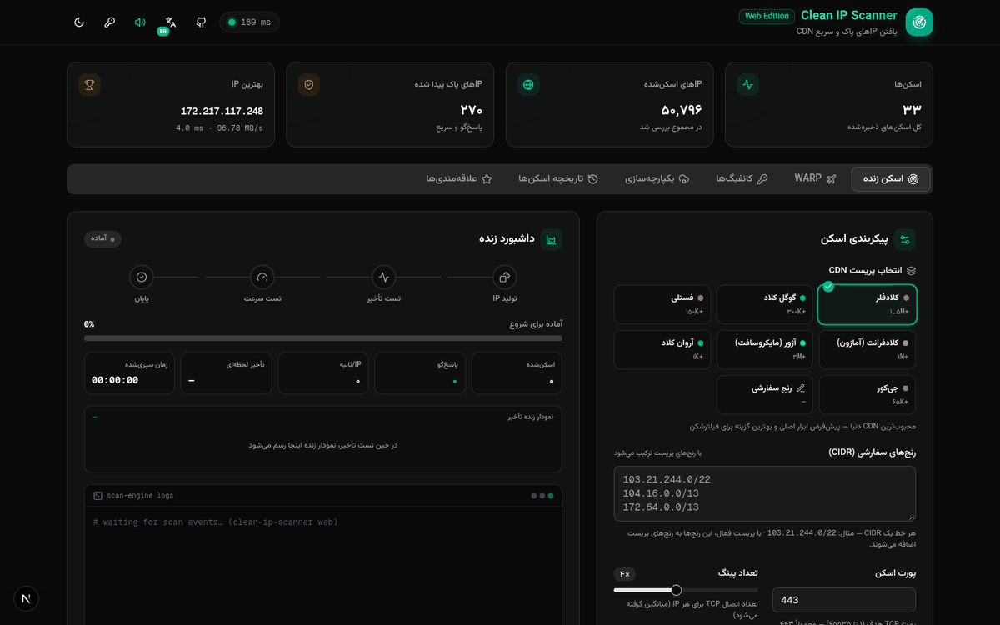
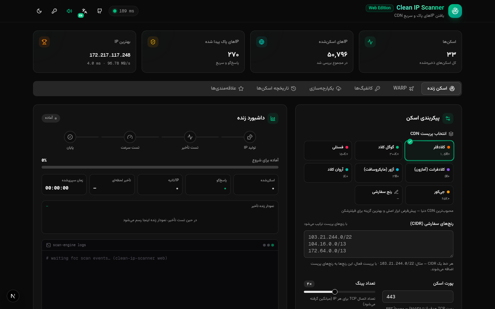
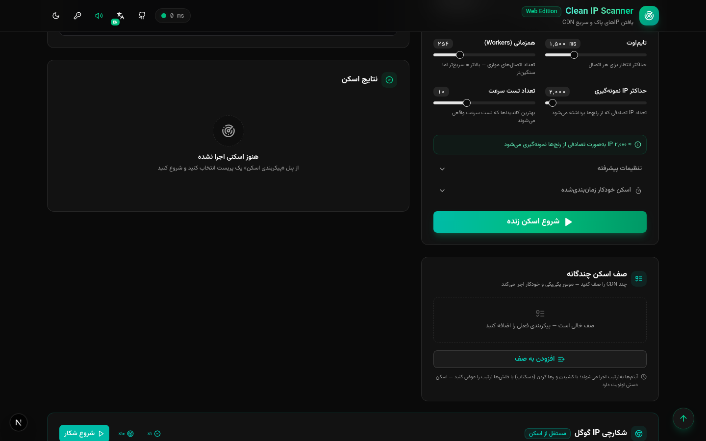
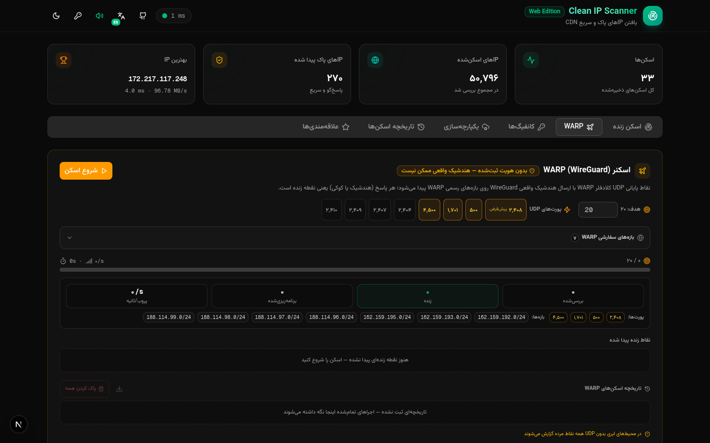
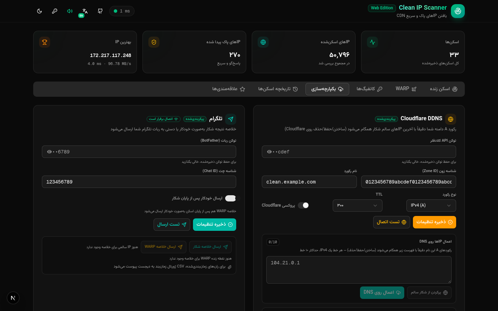
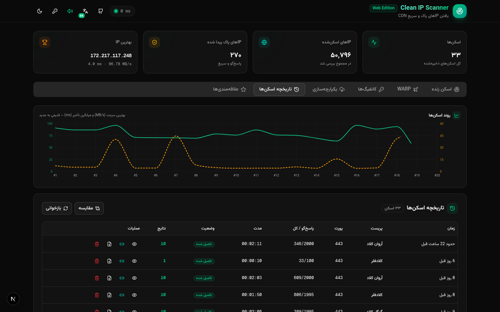
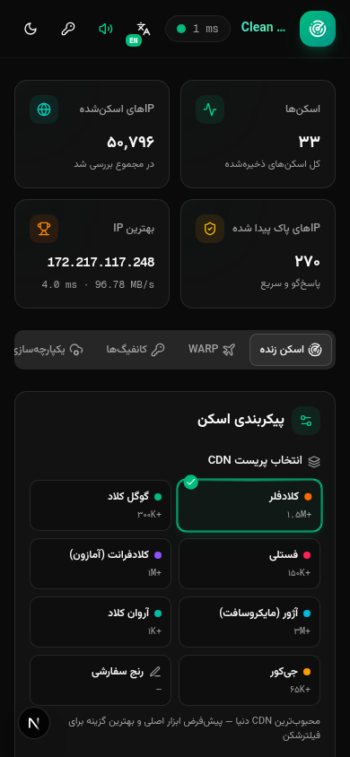
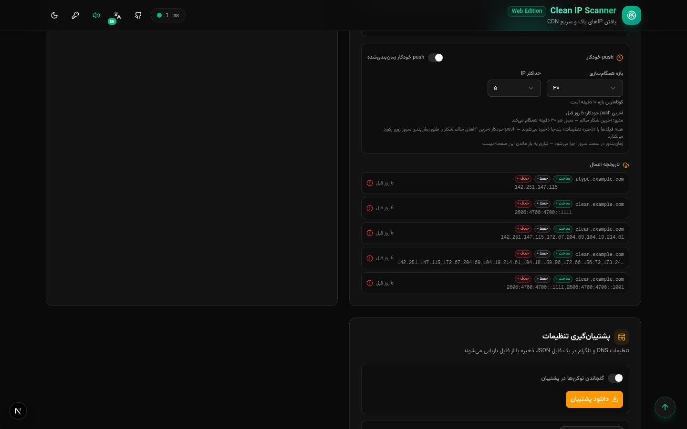
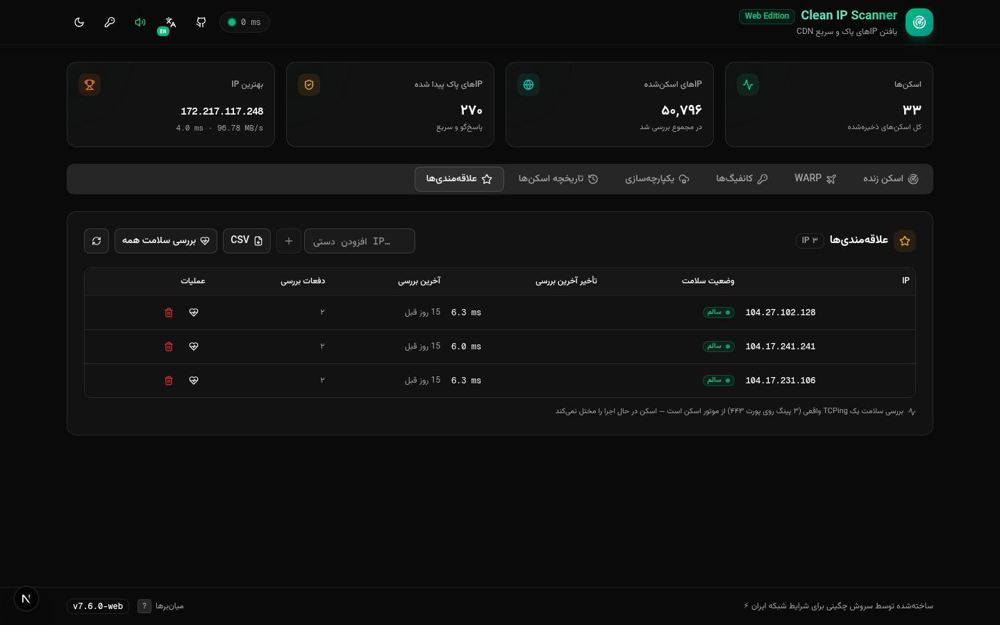
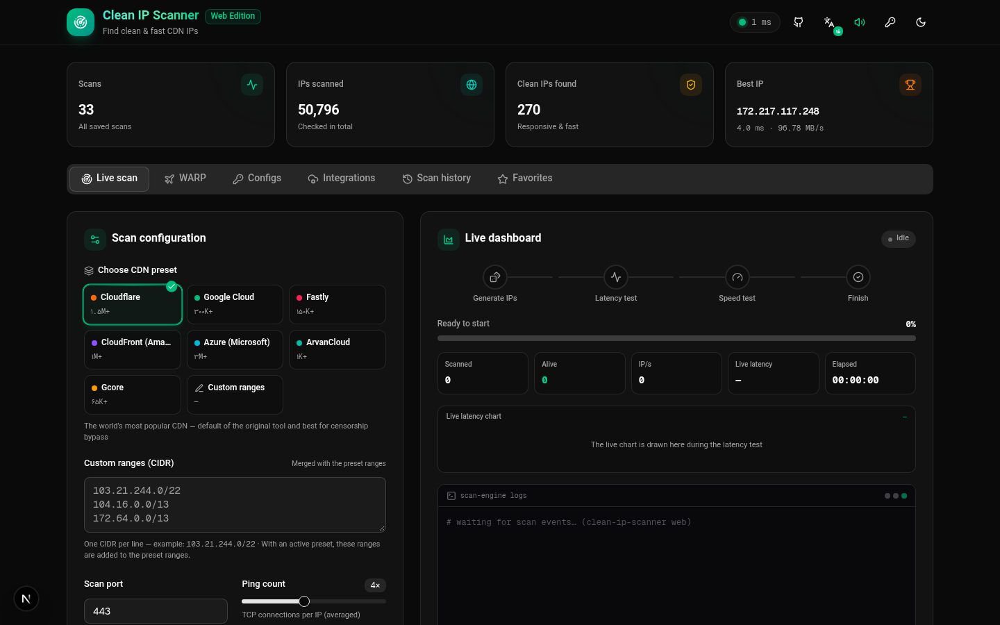

<p align="center">
  
</p>

<h1 align="center">Clean IP Scanner — Web Edition</h1>

<p align="center">
  <a href="https://github.com/CheginiSoroush/clean-ip-scanner/actions/workflows/ci.yml"></a>
  
  
  
  
  
  <a href="https://cheginisoroush.github.io/clean-ip-scanner/"></a>
</p>

<p align="center">
  <b>English</b> · Find clean, fast, CDN-friendly IPs in real time — live scanner, Google IP hunter,
  WARP endpoint probing, server-side hunt scheduler and Telegram digests, behind an RTL-first bilingual UI.
</p>

<div dir="rtl">
<p align="center">
  <b>فارسی</b> · پیدا کردن IPهای پاک، سریع و سازگار با CDNها در لحظه — اسکنر زنده، شکارچی IP گوگل،
  پروب WARP، زمان‌بان شکار سمت سرور و خلاصه‌سازی تلگرام، همه با رابط دوزبانه و راست‌به‌چپ.
</p>
</div>

---

<p align="center">
  
</p>

## 📖 Handbook (GitHub Pages)

The full illustrated user manual — setup, first scan, hunt scheduler, WARP,
Telegram digests, troubleshooting and FAQ — lives on **GitHub Pages**:

**→ [cheginisoroush.github.io/clean-ip-scanner](https://cheginisoroush.github.io/clean-ip-scanner/)**

It is bilingual (فارسی / English), fully animated and deployed automatically
via GitHub Actions from [`docs/`](./docs/).

## 📸 Screenshots

| Dashboard (fa) | Scan configuration |
| --- | --- |
|  |  |

| WARP scanner | Integrations |
| --- | --- |
|  |  |

| Scan history | Mobile (390×844) |
| --- | --- |
|  |  |

<details>
<summary><b>More views</b></summary>

| Telegram digest | Favorites | English UI |
| --- | --- | --- |
|  |  |  |

</details>

## ✨ Features

- **Live scanner** — TCP/TLS latency scanning across a configurable port matrix
  with verify levels, batch sizing, concurrency control and hard caps
- **CDN presets** — Cloudflare (1.5M+), Google Cloud (300K+), Fastly (150K+),
  CloudFront, Azure, ArvanCloud and Gcore out of the box; custom CIDR lists and
  IPv6 sampling supported
- **Google IP hunter** — hunts Google-facing IPs from live, reverse-engineered
  CIDR sources (SPF records, API ranges, RIPE snapshots…) with source health
  reporting and a built-in knowledge base
- **Hunt scheduler** — server-side recurring hunts with a persisted run journal;
  every fire records a compact **settings echo** (provider, target, batch,
  concurrency, host:port, speed, verify) that survives restarts
- **WARP scanner** — Cloudflare WARP endpoint probing with alive-rate reporting
  and history
- **Favorites & history** — tracked favorites with health checks, scan history
  with search/filter/sort, time-range chips (24h / 7d / all) and one-click
  **CSV export** for hunt history, WARP history and the scheduler journal
- **Telegram integration** — result digests (manual or auto-on-finish);
  scheduled-run digests automatically **attach the scheduler-journal CSV** via
  `sendDocument`
- **Cloudflare DDNS** — push the best clean IP straight to an A record
- **Polished UI** — RTL-first Persian + English (1,096-key dictionary), dark &
  light themes, keyboard shortcuts, mobile-first responsive layout

<div dir="rtl">

## ✨ امکانات (خلاصه فارسی)

- **اسکنر زنده** — اسکن تأخیر TCP/TLS با ماتریس پورت، سطوح تأیید، اندازه دسته، کنترل همزمانی و سقف‌های سخت
- **پریست‌های CDN** — کلادفلر، گوگل کلاد، فستلی، کلادفرانت، آژور، آروان کلاد و جیکور؛ به‌علاوه رنج‌های CIDR سفارشی و نمونه‌برداری IPv6
- **شکارچی IP گوگل** — شکار IPهای رو‌به‌گوگل از منابع زنده (رکوردهای SPF، رنج‌های API، اسنپ‌شات‌های RIPE…) با گزارش سلامت منابع و دانش‌نامه داخلی
- **زمان‌بان شکار** — شکارهای دوره‌ای سمت سرور با ژورنال ماندگار؛ هر اجرا یک **بازتاب تنظیمات** فشرده ثبت می‌کند که از ری‌استارت جان سالم می‌برد
- **اسکنر WARP** — پروب اندپوینت‌های کلادفلر WARP با نرخ زنده‌بودن و تاریخچه
- **علاقه‌مندی‌ها و تاریخچه** — جست‌وجو/فیلتر/مرتب‌سازی، بازه‌های زمانی (۲۴ساعت / ۷روز / همه) و خروجی CSV تک‌کلیکی
- **یکپارچه‌سازی تلگرام** — خلاصه نتایج (دستی یا خودکار)؛ اجراهای زمان‌بندی‌شده به‌طور خودکار CSV ژورنال را پیوست می‌کنند
- **DDNS کلادفلر** — ارسال بهترین IP پاک به رکورد A با یک کلیک

</div>

## 🏗 Architecture

```
Browser
  │
  ▼
Caddy gateway :81 ──▶ Next.js 16 (App Router) :3000
                          │  REST (Prisma + SQLite)  ·  socket.io client
                          ▼
                      Bun scan engine :3003
                      (socket.io · hunt scheduler · WARP probe · recon)
```

- **Web app** — Next.js 16, TypeScript 5, Tailwind CSS 4, shadcn/ui,
  TanStack Query, Zustand, Prisma (SQLite)
- **Scan engine** — standalone Bun + socket.io service (`mini-services/scan-service`)
  owning all network I/O: scans, hunts, scheduling, WARP, CIDR recon
- **Gateway** — Caddy front proxy unifying app and engine behind one port

## 🚀 Getting started

Requirements: [Bun](https://bun.sh) 1.1+

```bash
# 1. install
bun install

# 2. prepare the database
bun run db:push

# 3. start the web app (port 3000)
bun run dev

# 4. start the scan engine (port 3003)
cd mini-services/scan-service && ./run.sh
```

| Service     | Port | Notes                                  |
| ----------- | ---- | -------------------------------------- |
| Web app     | 3000 | Next.js dev/prod server                |
| Scan engine | 3003 | Bun + socket.io, started via `run.sh`  |
| Gateway     | 81   | Optional Caddy front proxy             |

> 📖 Step-by-step illustrated guide: **[the Handbook](https://cheginisoroush.github.io/clean-ip-scanner/)**

## 🔧 Scripts

| Script            | Purpose                              |
| ----------------- | ------------------------------------ |
| `bun run dev`     | Start the Next.js app in dev mode    |
| `bun run build`   | Production build (standalone output) |
| `bun run start`   | Run the standalone production server |
| `bun run lint`    | ESLint                               |
| `bun run db:push` | Push the Prisma schema to SQLite     |

## 📁 Project structure

```
├── src/
│   ├── app/               # App Router pages & API routes
│   ├── components/        # scanner panels, UI shell (shadcn/ui based)
│   ├── hooks/             # socket state & app hooks
│   └── lib/               # scan protocol, i18n, CSV builders, utils
├── mini-services/
│   └── scan-service/      # Bun scan engine (socket.io)
├── docs/                  # GitHub Pages handbook (static, animated)
├── .github/workflows/     # CI + Pages deployment
├── prisma/                # schema (SQLite)
└── Caddyfile              # gateway config
```

## 🌍 Internationalization

Persian is the default language (RTL). Every visible string lives in a single
symmetric dictionary (`src/lib/i18n.ts`, fa = en); English flips the layout to
LTR at runtime.

## 📄 License

[MIT](./LICENSE) © [Soroush Chegini](https://github.com/CheginiSoroush)
